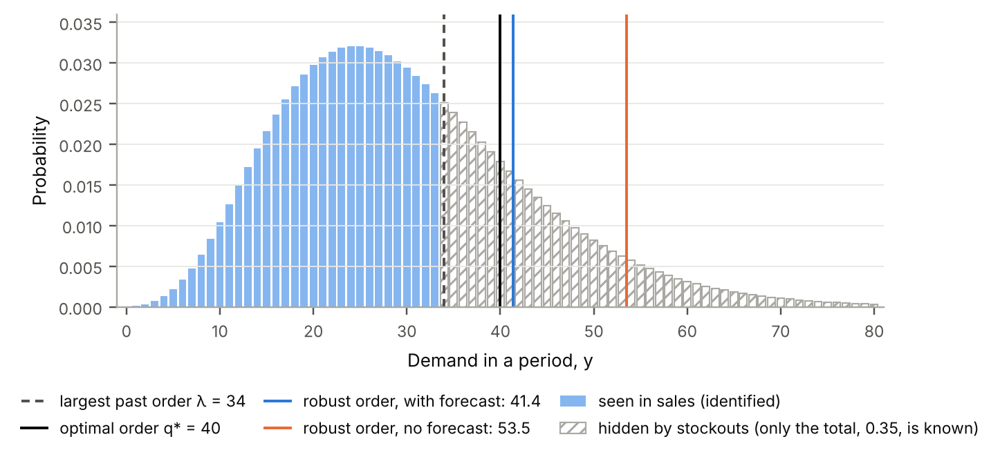
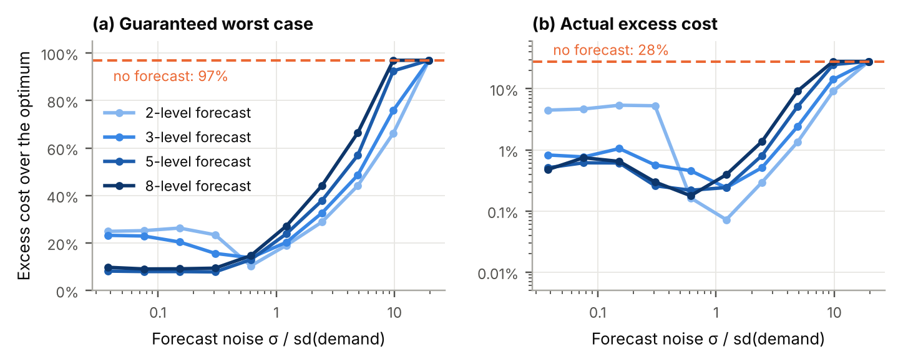

# How much is an AI forecast worth when sales are censored?

A pilot study of the robust newsvendor when stockouts hide demand and a coarse AI forecast is available as a *weak shadow variable* (Chen, Simchi-Levi & Xiong, 2026).

When a store sells out, its sales record stops at the shelf count. If that happens often enough, the optimal order cannot be learned from sales, and a robust order must hedge against the worst demand the data allow (Hssaine & Sinclair, 2024). A demand forecast is still observed in stockout periods. Under an assumed error model, it adds linear constraints on the hidden demand. This repo measures how much those constraints are worth.

**Headline (critical ratio 0.8, demand mean 30, sd 13; past orders up to 34; optimal order 40):**

| Policy | Order | Actual excess cost | Guaranteed worst case |
| --- | --- | --- | --- |
| Treat sales as demand | 30 | 28.6% | none |
| Robust, no forecast | 53.5 | 28.0% | 97% |
| Robust, 5-level forecast (noise σ = 4) | 41.4 | **0.26%** | **7.8%** |
| Same, everything estimated from 1,000 periods (median of 100 runs) | 40.8 | 0.61% | guarantee held in 100/100 runs |

Excess cost is the regret as a share of the optimal expected cost. The guaranteed worst case is the LP's certificate over every demand distribution consistent with the data.





## What is in here

- **One LP for the robust order.** Minimax regret over the ambiguity set, with the forecast's constraints relaxed by an l1 budget δ, is written as a single linear program by dualising the inner worst case (`src/pilot/robust.py`; derivation in the note, Proposition 1).
- **Verified two ways.** Without a forecast, the LP reproduces the Hssaine–Sinclair closed form to about 1e-14. With a forecast, its value equals the worst case found by solving every inner primal LP directly, and no other order does better (`tests/test_robust.py`).
- **Estimation from data.** Kaplan–Meier for censored demand; maximum likelihood for the forecast's error model on uncensored periods; a sampling allowance for δ (`src/pilot/data.py`, `ambiguity.py`, `signal.py`).
- **Five experiments.** E1 closed-form check. E2 value against forecast noise and number of buckets. E3 value against censoring severity. E4 a forecast that under-predicts high demand. E5 finite samples.
- **A 5-page note** with the model, the result, figures and limitations: [`note/note.pdf`](note/note.pdf).

## Run it

```bash
pip install -r requirements.txt
pytest                                   # 26 tests, about 20 s
python experiments/run_all.py            # all experiments, about 2-3 minutes; writes results/*.json
python experiments/make_figures.py       # writes figures/*.pdf and *.png
cd note && latexmk -pdf note.tex         # optional: rebuild the note
```

## Layout

```
src/pilot/
  newsvendor.py   costs, critical quantile, regret, Hssaine-Sinclair closed form
  demand.py       truncated negative binomial demand
  signal.py       bucketed noisy forecast, its error kernel, MLE of (mu, sigma)
  data.py         simulated sales history, Kaplan-Meier, naive sales quantile
  ambiguity.py    the ambiguity set (population or estimated), feasibility check
  robust.py       the single robust LP, and the brute-force primal check
experiments/      config.py (every parameter), run_all.py, make_figures.py
tests/            26 tests
results/          numbers behind every figure (JSON)
figures/          PDF and PNG
note/             note.tex and note.pdf
```

## Findings in one paragraph each

1. **A coarse forecast removes almost all of the cost of censoring** until its noise exceeds the spread of demand. With 3 or more levels the actual excess cost stays at or below about 1% while the noise is below the demand spread. At σ = 128 the five-level forecast recovers 11% of the loss; at σ = 256, nothing.
2. **The heavier the censoring, the more it is worth.** As the share of demand seen falls from 0.79 to 0.23, the robust order without the forecast goes from 1.2% to 74% excess cost; with it, below 0.4% throughout.
3. **A wrong error model can break the guarantee.** If the forecast under-predicts demand above the boundary, the bias is invisible in uncensored data. At δ = 0 the LP then claims 0.8% while the truth is 3.4%. A small δ restores a valid guarantee, but the order stays biased low.
4. **It survives estimation.** Median excess cost is 1.6% at 250 periods, 0.61% at 1,000 and 0.08% at 4,000, against about 28% for both alternatives.

One caution: with infinite data and an exactly known error model, even a nearly pure-noise forecast keeps real value, because a known smooth error kernel still reveals averages of the tail. That information disappears under sampling error. This is why the infinite-data experiments include a sampling allowance for 1,000 periods.

## Limitations

- The δ allowance is a heuristic with no formal coverage guarantee. Chen et al. give valid inference (an l1-penalised LP with a data-driven radius and recentred subsampling). Implementing it is the next step.
- The error model's validity in the tail cannot be tested from censored data (finding 3).
- If past orders were set from the forecast itself, stockouts depend on the forecast and the exclusion assumption fails. This case is open.
- Synthetic data, one product, no covariates, one period at a time.

## References

- H. Chen, D. Simchi-Levi, R. Xiong. *Partial identification under missing data using weak shadow variables from pretrained models.* [arXiv:2602.16061](https://arxiv.org/abs/2602.16061), 2026.
- C. Hssaine, S. R. Sinclair. *The data-driven censored newsvendor problem.* [arXiv:2412.01763](https://arxiv.org/abs/2412.01763), 2024.
- J. Bu, D. Simchi-Levi, L. Wang. *Offline pricing and demand learning with censored data.* Management Science 69(2), 2023.
- E. L. Kaplan, P. Meier. *Nonparametric estimation from incomplete observations.* JASA 53(282), 1958.
